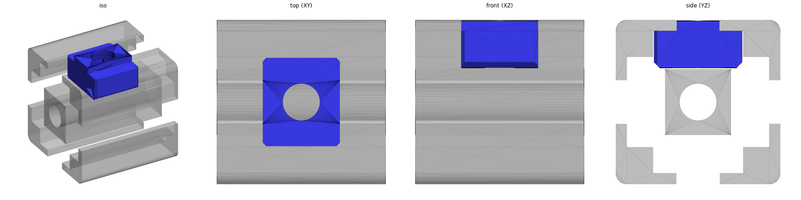
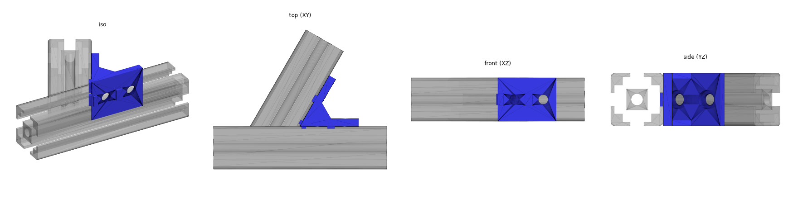
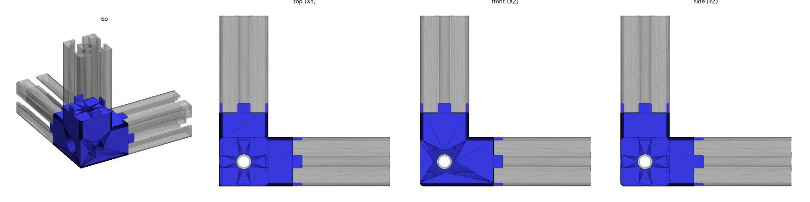
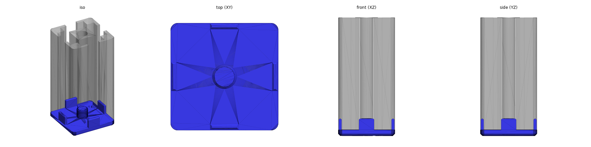
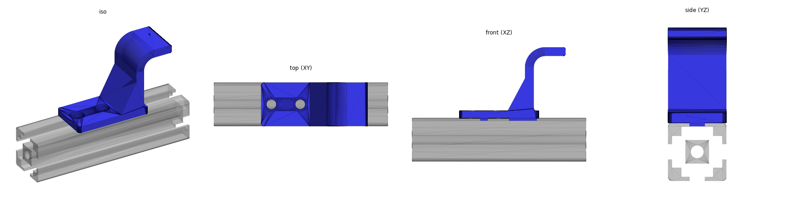
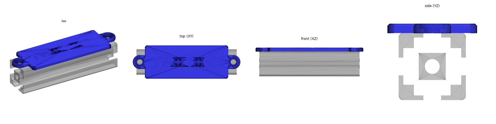
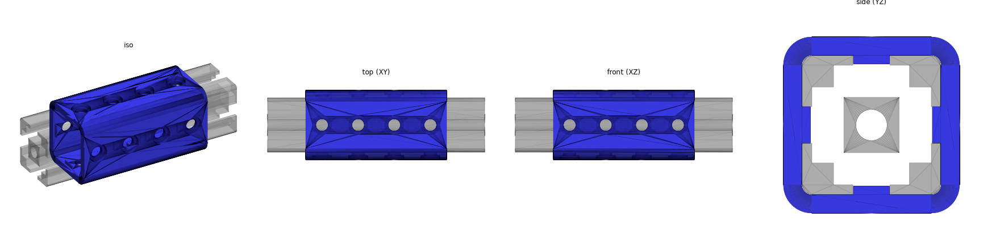
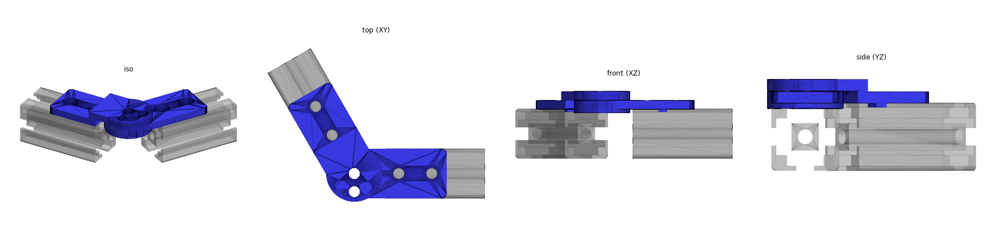

# SLOTLAB

Parametric, 3D-printable hardware for T-slot aluminium extrusions:
2020 / 3030 / 4040 (slot 6, 8, 10): T-nuts, joint plates, elbows,
brackets, end caps, slot-mounted accessories, signs, inline splices
and pivot joints, with text or SVG branding. Sliders in the browser, CadQuery on
the server. Sister of BOXLAB and KNOBLAB.

| | | | |
|---|---|---|---|
|  |  |  |  |
|  |  |  |  |

## Run

    git clone https://github.com/mdrndesigns/slotlab.git
    cd slotlab
    python3 app.py

Opens http://localhost:8767. Ctrl-C to stop.
Port clash: `python3 app.py --port 8768`

## Dependencies

    pip install -r requirements.txt

Only CadQuery; the server is standard library. `shapely` is optional
(repairs messy SVG outlines). Tested on Python 3.14 with CadQuery 2.8;
older CadQuery releases need Python 3.10–3.12 for the OpenCascade wheels.
The UI loads three.js from unpkg, so the browser needs network access.

## Files

    profiles.py    extrusion presets (Misumi-verified and typical),
                   steel T-nut references, slot load limits
    fasteners.py   ISO 273 holes, ISO 4032 / DIN 934 / DIN 439 nuts,
                   ISO 4762 / ISO 10642 heads, hex keys, heat-set inserts,
                   material clearances
    model.py       parameters, validation, the nine part families,
                   extrusion context, polygon helper
    branding.py    fonts, SVG parser, text / artwork placement
    fonts/         IBM Plex (OFL)
    app.py         local server, stdlib only
    index.html     UI + three.js viewport
    tests/         batch.py (independent mesh verification),
                   smoke.py, render.py, samples.py
    samples/       preview renders and parameter sets

## Tests

    pip install -r requirements-dev.txt
    python3 tests/batch.py      # builds every case, checks meshes independently
    python3 tests/smoke.py      # one of each family + renders
    python3 tests/samples.py    # regenerates samples/ (STEP, STL, 3MF, previews)

Output goes to the system temp dir; set `SLOTLAB_OUT` to change it.
STEP / STL / 3MF files in `samples/` are not committed; run
`tests/samples.py` to build them.

## Profile first

A name does not fix a slot. "4040" is slot 8 (core Ø6.8, M8) or slot 10
(core Ø10.5, M12). "2020" has a Ø4.2 core (Misumi, V-slot, Chinese
stock) or Ø5.5 (Bosch, Motedis, Alux B-type). So every preset is a full
set of numbers and every number is a slider: pick the nearest preset,
measure your stock, correct the sliders. Presets marked *manufacturer
drawing* are from the Misumi catalogue; the rest are typical vendor
figures.

    opening    slot width at the face
    lip        face to cavity ceiling
    cavity_w   width under the lips
    cavity_d   ceiling to floor
    core       centre bore (end-tap size)

## Families

**tnut** — slide-in (full head, neck in the opening) or drop-in (body
passes the opening, rotates 90° in the cavity; corner radius computed so
it can). Fastening, strongest first:

    hex      captive hex nut, loaded from the bottom (cavity-floor side)
             so the bolt pulls it against printed material in compression.
             `End` loads it from the end face and leaves a floor under it
             (captive out of the slot). A snap lip keeps a bottom-loaded
             nut in. ISO 4032, DIN 934 or DIN 439 thin.
    insert   heat-set insert, pressed in from the bottom for the same
             reason. Hole from the table (CNC Kitchen: 4.2 for M3).
    thread   printed ISO 60° thread through the full height. M3/M4 are
             refused (tooth under the extrusion width), M5 is warned.
             Radial clearance from the material preset. The preview shows
             a plain minor bore unless `Render thread` is on; export
             always cuts the real thread.
    plain    clearance bore (through bolt, or a slot slider)

The readout shows side wall, ceiling above the nut, and the Bosch steel
limit for the slot. Walls under 0.8 mm and ceilings under 0.6 mm are
refused.

**plate** — gusset plate on the planar faces of two members meeting at
any angle (180 = splice). Legs are mitred at the bisector like the
members; the inner corner is filled by a chord (`gusset`). Bolts into
slide-in T-nuts; a tongue under each leg rides in the slot opening and
is windowed where the T-nut neck sits. First hole position is computed so
the whole T-nut head clears the mitre. Print flat, tongues up.

**elbow** — mitre-elbow block for square-cut members, bolted into the
end-tapped core (the strongest joint class per Bosch's tables). The bolt
head sits behind `bolt_wall` of material; the access bore comes out of
the far face. Four keys on each end face enter the slot openings and
stop rotation. Third arm along Z makes a corner cube. Angle 35–170°.

**bracket** — inside-corner angle bracket for T-joints, mid-span joints
and frame corners, 30–180°. Two legs with tongues and T-nut bolts, side
webs (clear of the bolt heads) or a full web. `Slot notch` keys the legs
into the slot openings (Keyed) or leaves them flat so the bracket can be
mounted turned or on a plain face (Flat). `Rotate` turns the bracket
about the corner line in 90° steps, in the preview and in the export.
Print on its side so the corner bends inside the layers.

**cap** — end cap for a square-cut member. Rounded-rectangle plate
(corner radius follows the profile, oversize it to cover the sharp
aluminium edge), outer edge square / chamfered / filleted, a safety
radius you can raise. Held by four slot plugs: `keys` fill the lip
opening, `tee` adds a head in the cavity, both with a press-fit `grip`
and lead-in chamfers; plus a core plug into the centre bore. A centre
hole (plain, counterbored, countersunk) takes a bolt into the
end-tapped core and replaces the core plug; the readout says if the
head stands proud. Print outer face down.

**acc** — accessory on a base plate: bolts into slide-in T-nuts below
the head, tongue in the slot, counterbores. Heads:

    hook      J-hook, full base width by default, rib under the arm,
              cove fillet at the root, rounded tip
    peg       straight bar with a stop lip
    drivers   shelf with round holes (screwdrivers, markers)
    hexkeys   shelf with one hole per key, 1.5 mm up to 10 mm
    wrenches  comb of open slots, handles drop in
    pliers    shelf with one long window: handles through, jaws on the rails
    tray      rimmed tray, magnets drop into top pockets (Ø + 0.3, t + 0.2);
              prints floor down with the base standing at the back
    clip      wire block: snap-in C channels, closed loops or an open comb,
              round wire Ø or flat cable w × t, any count, wall and snap lip

`Along` points the head along the slot (vertical member, X up).
`Across` turns it 90° for a horizontal member with the slot facing you;
racks then run along the top edge of the base with ribs at the ends.
Hooks and pegs print on their side (J flat on the bed); racks print
standing on the shelf's top face. Both put the layers in the bending
plane.

Pick a polygon (△ □ 5 6 8 12) to set the interior angle; the note gives
the mitre from square and the outer/inner edge lengths for a chosen
centreline side.

**sign** — name plate, w × h × t, corner radius, edge chamfer or
fillet. Mount: none, T-nut bolts, or a slot edge key (a T-key along
the bottom edge that slides into a member; the sign stands up from the
rail). Bolts: holes `in the plate` near the edge (head + 1.5 mm wall,
or set the margin / slot line) or in `ears`, D-shaped tabs outside the
edge sized to the bolt head. Holes at the `bottom edge` (one rail),
`top + bottom` (two rails), or at the `sides`: one bolt at each end on
a rail hidden behind the centre line, so the branding takes the whole
face between the heads (or the whole plate with ears). Holes spread
from the ends at an inset or centred at the pitch; counterbores from
the Bolts group. An optional border lip on
the face: raised rim or groove, with height, width and inset (`No
lip` is the default). Branding sits in the free
band clear of the heads, or at the plate centre (the `Centre` button
also zeroes the X / Y offsets). Print flat (bolts, none) or standing on
the key (slot).

**splice** — inline extension of two members. `Sleeve` wraps 1–4
faces across the joint (plate, L, U or box) with keys in the slot
openings and bolts into slide-in T-nuts on every covered face; slide the
nuts in from the ends before closing the joint. `Slot bar` is a long
slide-in T-nut body across the joint with grub screws at each end:
captive nuts load from below with a snap lip (thin nuts are chosen
automatically when the cavity is shallow), the screws reach through the
opening, press the cavity floor and jam the bar under the lips. Friction
only; one bar per slot, or a sleeve, for load.

**pivot** — movable joint. Leaf A bolts to member 1 and carries the
lower lug with the nut captive underneath; leaf B bolts to member 2 and
steps up over lug A to the upper lug. One bolt or a KNOBLAB knob from
the top gives a friction lock; `Arc slot + bolt` adds a second bolt in
lug A riding in a slot in lug B that covers the chosen swing. The
readout gives the free swing before the members or arms collide.
Allowances: pivot bore clearance, lug gap (washer), nut pocket fit from
the material preset, knob diameter to seat. Export each leaf on its own.

## Branding (end cap, sign)

Text in a bundled font (`fonts/`: IBM Plex Sans, Serif and Mono,
regular and bold, SIL Open Font License) or an uploaded SVG. Recessed,
raised or cut through; size (0 = fit the face), depth, rotation, X/Y
offset, line spacing. Characters the font cannot draw (emoji, block
symbols) are dropped with a warning instead of printing as boxes; use
an SVG for those. The SVG parser is standard library only: paths
(M L H V C S Q T A Z), rect, circle, ellipse, polygon, polyline, groups
and transforms. Separate shapes add, a white fill knocks out, even-odd
applies inside one path; strokes, text and images are ignored, so
convert those to outlines first. With `shapely` installed, messy
outlines are repaired. Uploads live in the server's memory; the export
ZIP carries the SVG beside the script.

`Two filaments` makes the branding its own body: a flush inlay that
fills the recess, raised letters standing on the face, or an insert
through the whole plate. The preview shows it in orange. The export
then holds a standard 3MF with one object and two parts (base, brand)
that Bambu Studio and PrusaSlicer open as a multi-part object, so each
part gets its own filament (right-click the part → Change filament),
plus one STL per part and a note with the steps.

## Clearances (material presets, PETG shown)

    hex pocket AF      +0.30     neck / tongue / key   −0.20
    pocket depth       +0.30     bolt hole             ISO 273 + 0.20
    head width         −0.40     printed thread        +0.25 radial

Steel references the tool copies: neck 5.8 / 7.8 / 9.8 for slot
6 / 8 / 10.

## Sources

Misumi HFS5 / HFS6 / HFS8 catalogue drawings; Misumi HNTT / HNTA / HNTP
nut tables; Bosch Rexroth connector and slot load tables; ISO 4032,
DIN 934, DIN 439, ISO 4762, ISO 273; CNC Kitchen insert / nut pull-out
tests; cq_warehouse thread docs.

## Licence

Fonts in `fonts/` are IBM Plex under the SIL Open Font License
(`fonts/LICENSE-OFL.txt`).
# slotLab
